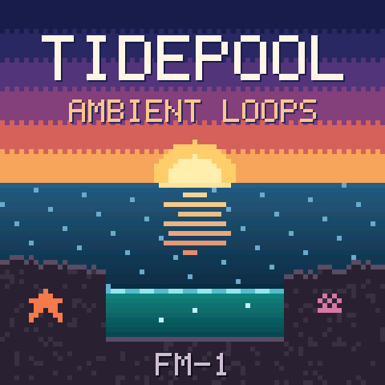

# Tidepool for the M-VAVE FM-1



Tidepool is an ambient loop instrument, here as custom firmware for the
[M-VAVE FM-1](https://www.m-vave.com/) pocket synth. Each bank is a scene with sixteen loops (drones, textures,
melodies and beats). Turn them on and off from the keys and they always fit together, in time and in key. You can
reshape them with the knobs, change their chords, or hand the whole thing over to autoplay and just listen. A
thirteenth bank, the Blank Canvas, is yours to fill: record your own loops on 36 instruments.

Every sound is synthesised live on the FM-1. There are no samples: each note is built from oscillators, filters,
envelopes and noise as it plays, so changing the chords takes effect at once.

> **Unofficial firmware.** This is a hobby project, not made or supported by M-VAVE. Installing it replaces the
> FM-1's own firmware until you put that back (see [Going back to the stock firmware](#going-back-to-the-stock-firmware)).
> Use it at your own risk.

**[Install it from your browser](https://pjh-133.github.io/tidepool-fm1/install/)** (Chrome or Edge, FM-1 connected
by USB), or **[try it in the browser](https://pjh-133.github.io/tidepool-fm1/emu/)** first: the same firmware, with
sound, no FM-1 needed.

<br clear="right">

## The scenes


| # | Bank | Mood |
|---|---|---|
| 1 | **Shallows** | Under the water: a low drone, glass arpeggios, kalimba, rain and ocean |
| 2 | **Deep Space** | Event horizons, star bells, sonar and a lone flute |
| 3 | **Forest Floor** | Earth hum, cello, marimba, crickets, a stream and an owl |
| 4 | **Neon Rain** | A city at night: Juno pads, chord stabs, lo-fi beats, rain on glass and traffic |
| 5 | **Dungeon Synth** | Stone organ, lost choir, harpsichord, war drums and cave drips |
| 6 | **Aurora** | The northern lights: glassy pads, ice bells, whale song and sleigh bells |
| 7 | **Dunes** | Dusk in the desert: tanpura, oud, ney flute, darbuka and a campfire |
| 8 | **Zen Garden** | Spring rain in a temple garden: sho, koto, shakuhachi, taiko and wind chimes |
| 9 | **Clockwork** | A workshop of gears: music box, celesta, reed organ, tick-tock and a cuckoo |
| 10 | **Night Café** | Late-night jazz, swung: walking bass, Rhodes, muted trumpet, brushes, rain on the window |
| 11 | **Bonfire** | Dark fantasy among ruins: a cathedral organ, a solo cello, a lone soprano and a fire to rest at |
| 12 | **Old Blood** | A gothic nightmare: choir, tremolo strings, a warped music box, church bells and crows |
| 13 | **Blank Canvas** | Empty: record your own loops |

Each bank has its own colours, an animated pixel-art banner and its own shape of pool. Bonfire and Old Blood are
written in the mood of Dark Souls and Bloodborne, but every sound, chord and picture in them is original.

## Playing it

The screen shows the bank's name and tempo, its four chords (the current one lit), and sixteen pools in four rows.
Each pool is a loop that glows in its row's colour while it plays.

### The keys and knobs

| Control | What it does |
|---|---|
| **White keys 1–16** | Turn a loop on or off. Rows, top to bottom: drones, melodies, beats, then textures (rain, wind, fire: the scene's atmosphere). A loop waits for the next beat to come in, blinking until it does |
| **KNOB 1–4** | Adjust the selected row's four loops, one knob each |
| **OCT− / OCT+** | Choose what the knobs adjust: Volume, Attack, Decay, Reverb, Echo or Pan (shown bottom left) |
| **ALGORITHM** | Choose the row the knobs adjust. Pressing a key selects its row too |
| **SELECT** | Tempo (56–140 bpm) |
| **MASTER** | Main volume |
| **PRESETS** | Change bank. Everything fades out, then the new bank is ready |
| **SAVE** | Remember the tempo, the bank and every loop's settings in every bank. Lit when there's something unsaved |

### Play, chords and autoplay

| Control | What it does |
|---|---|
| **PLAY** | Stop everything. Press again to bring back the same mix |
| **Hold PLAY, turn KNOB 1** | Change the bank's chord progression. 0 is the bank's own; 1–99 are new ones in the same key, each the same every time. The change comes in at the next bar. Hold PLAY for a moment and the screen reminds you |
| **SEQ** | **Autoplay.** Tidepool brings loops in and out on its own, once every four bars (faster at higher tempos). It builds up from nothing to about two loops in each row, keeps every row going, changes the chords now and then, and changes the texture only rarely. It works on any bank, the Blank Canvas included |
| **SEQ again** | **End autoplay gracefully.** Loops drop out a few at a time, every four bars (the beat first, the drones last), until everything has stopped. SEQ blinks while it ends; press SEQ once more to change your mind |
| **Hold HOME for 3 seconds** | **Surprise me:** a random mix with random settings. A countdown shows on screen; let go early and nothing happens |

## The Blank Canvas: record your own loops


The thirteenth bank starts empty. Its sixteen pools fill with loops you record, and each one keeps its own instrument.
Once recorded, they play like any other bank: turn them on and off, adjust them with the knobs, autoplay them.

**To record a loop:**

1. Turn PRESETS to the Blank Canvas, then press **GLO** to enter recording mode (GLO lights up). The keys now play
   an instrument, and they respond to how hard you press.
2. Set the loop up:
   - **PRESETS** chooses the instrument.
   - **KNOB 1** sets the loop's length: 1, 2 or 4 bars.
   - **KNOB 2** sets the snap: off, 1/16, 1/8, or BAR, where each note starts on a bar line and lasts whole bars,
     for held chords.
   - **KNOB 3** turns the click on or off.
   - **OCT− / OCT+** shift the keys' octave.
3. Press **REC** to start a new loop in the next free pool.
4. Press **REC** again. A one-bar count-in starts at the next bar line, then recording begins.
5. Play. The loop goes round and round its length, and each pass adds to what's already there, so you can build it
   up layer by layer.
6. Press **REC** a third time to keep it. It is saved straight away; no need to press SAVE.

GLO during a take cancels it. **GLO** or **HOME** takes you back to playback. **PLAY** starts and stops the mix
while you record, so you can record over other loops.

**To delete a loop:** hold **EDIT** and tap the loop's key (its pool blinks red), then tap the same key again. Any
other key cancels.

### The 36 instruments

| Kind | Instruments |
|---|---|
| Keys | Felt keys, Warm organ, Rhodes, Harpsichord, Celesta, Toy piano |
| Plucked and struck | Glass bell, Kalimba, Pluck, Harp, Marimba, Music box, Nylon guitar, Vibraphone, Koto, Oud, Steel pan |
| Strings, winds and voices | Soft pad, Choir, Cello, Flute, Mellow brass, Strings, Shakuhachi, Violin, Muted trumpet, Soprano |
| Leads | Chip lead, Synth lead |
| Bass | Sub bass, Moog bass, Upright bass |
| Bells | Temple bell, Singing bowl |
| Drums | **Drum kit** and **Hand drums**: each key plays a different drum (the octave buttons don't change them) |


**Drum kit**, from the lowest key: kick, rim, snare, clap, low tom, closed hi-hat, mid tom, high tom, pedal hi-hat,
crash, open hi-hat and ride. From the second F up: deep kick, shaker, brush, tambourine, cowbell and ride. The top
keys repeat the main drums.

**Hand drums**: darbuka (deep and rim strokes), riq, frame drum, taiko and small taiko, wooden clappers, udu,
finger cymbals, two agogo bells and shaker, repeating up the keyboard.

## Installing

The easiest way is the **[web installer](https://pjh-133.github.io/tidepool-fm1/install/)**. Open it in Chrome or
Edge, connect the FM-1 by USB, and press Install. The browser asks once for permission to use MIDI: allow it.
Don't unplug the FM-1 while it writes. The same page can put M-VAVE's own firmware back.

Your settings and recorded loops survive later updates of Tidepool.

## Ask Claude about it

Tidepool comes with a [Claude](https://claude.ai) skill. Once it's added, you can ask Claude things like "how do I
record a drum loop?", "which bank has a cello?" or "what does ALL 16 LOOPS USED mean?" and get answers from how
Tidepool actually works.

- **Claude Code:** add this repository as a plugin marketplace, then install the plugin:

  ```
  /plugin marketplace add pjh-133/tidepool-fm1
  /plugin install tidepool-fm1@tidepool-fm1
  ```

- **Claude.ai and the Claude desktop app:** download
  [tidepool-fm1-skill.zip](https://github.com/pjh-133/tidepool-fm1/releases/latest/download/tidepool-fm1-skill.zip),
  then upload it under Settings → Capabilities → Skills. (Custom skills need a plan that includes them; you may need
  to switch skills on in that page first.)

The skill is in [`plugin/skills/tidepool-fm1/`](plugin/skills/tidepool-fm1/): it only explains how to use Tidepool,
and needs no access to anything else.

## Building it yourself

To change Tidepool or build it from source, you build the firmware, then send it to the FM-1 over USB.

The firmware is built on [fm1-base](https://github.com/charlesvestal/fm1-base), which is included here as a git
submodule. Its README covers the toolchain in more detail.

**You'll need:**

- Python 3, with `mido` and `python-rtmidi` for installing (`pip install mido python-rtmidi`).
- JieLi's toolchain for the FM-1's chip, and their AC79 SDK. fm1-base fetches both for you (below).
- On a Mac, Docker: the toolchain is Linux-only, so the build runs it in a container automatically.

**1. Get the code and the tools**

```bash
git clone --recursive https://github.com/pjh-133/tidepool-fm1
cd tidepool-fm1
base/tools/get_toolchain.sh          # JieLi's toolchain, into ~/.jieli/toolchain
base/bsp/tools/get_sdk.sh            # JieLi's AC79 SDK, into ~/.jieli/ac79-sdk
```

**2. Build**

```bash
AC79_SDK=~/.jieli/ac79-sdk JIELI_TOOLCHAIN=~/.jieli/toolchain python3 base/tools/build.py firmware
```

This makes `firmware/build/tidepool.fwsc`.

**3. Install**

Connect the FM-1 by USB and switch it on, then:

```bash
python3 base/bsp/tools/fm1_install.py firmware/build/tidepool.fwsc
```

It asks before writing. Don't unplug the FM-1 while it writes (about a minute). If an install is ever cut off, the
FM-1 waits in update mode: run the same command again and it finishes.

### Going back to the stock firmware

Use "Back to the stock firmware" on the [web installer](https://pjh-133.github.io/tidepool-fm1/install/), or install
M-VAVE's official firmware file from the command line:

```bash
python3 base/bsp/tools/fm1_install.py FM-1.fwsc
```

### Try it without an FM-1

The [browser version](https://pjh-133.github.io/tidepool-fm1/emu/) is the quickest. To build things locally,
fm1-base's host simulator runs the same firmware on your computer, with no toolchain needed. It's driven by
scripts, which take screenshots and record WAV files as they go:

```bash
python3 base/tools/build.py firmware --host
firmware/build/host/tidepool_host firmware/tests/newbanks.txt firmware/build/host
```

The scripts in `firmware/tests/` cover each part: the banks, the Blank Canvas, autoplay, the instruments and
settings from older versions.

## How it's made

The first five banks are a port of the original Tidepool web app, a browser instrument built on Web Audio,
translated into C for the FM-1's chip. The other seven, and the extra instruments, were written for the FM-1 in
the same style. The engine, the banks, and how everything was measured and tested are described in
[docs/DEVELOPMENT.md](docs/DEVELOPMENT.md).

| Folder | What's in it |
|---|---|
| `src/` | The sound engine and the banks: oscillators, filters, envelopes, reverb, echo, and each bank's sixteen loops |
| `firmware/` | The FM-1 app: the panel, the screen and its pixel art, saving, the recorder, autoplay, and the tests |
| `host/` | A Mac benchmark that renders the banks to WAV and estimates their cost on the FM-1 |
| `web/` | An older browser emulator of the panel (first bank only); the [site's](https://pjh-133.github.io/tidepool-fm1/emu/) is the whole firmware |
| `firmware/site/`, `firmware/docs/` | The website's front page and manual |
| `plugin/` | The Claude skill (with `.claude-plugin/` at the top, the plugin marketplace for Claude Code) |
| `base/` | [fm1-base](https://github.com/charlesvestal/fm1-base), the platform layer (git submodule) |

## Credits and licence

Tidepool's own code is under the [Mozilla Public License 2.0](LICENSE).

It's built on [fm1-base](https://github.com/charlesvestal/fm1-base) by Charles Vestal and
[felucca-bsp](https://github.com/hugelton/felucca-bsp) by Leo Kuroshita (Hügelton Instruments), both MPL-2.0.
They provide the FM-1's hardware layer, screen drawing, saving, USB and the installer. Thanks to everyone in the
FM-1 firmware community whose work made custom firmware possible.

M-VAVE and FM-1 are trademarks of their owners. This project is not affiliated with them.
