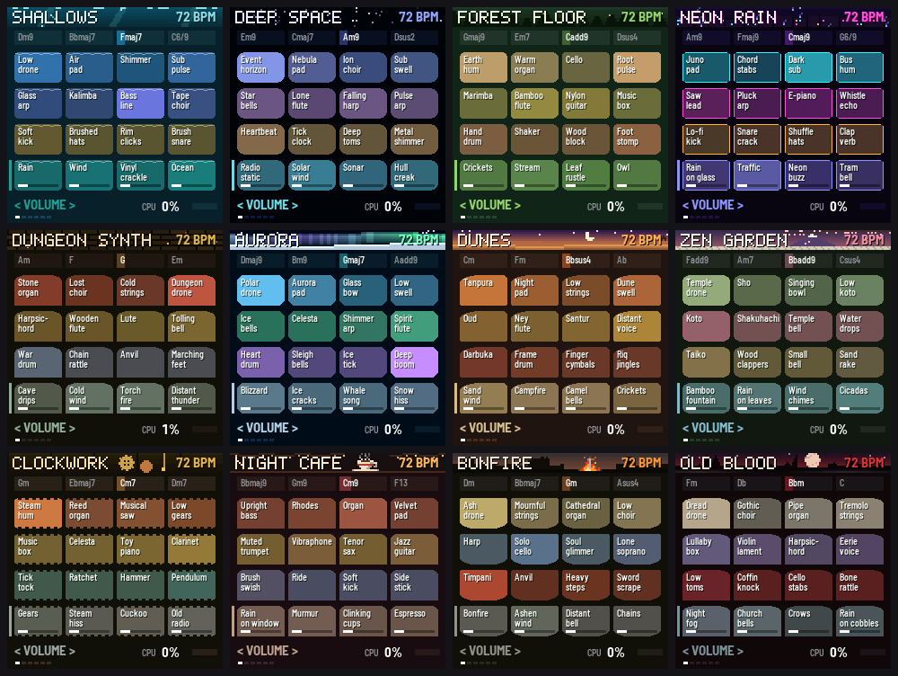
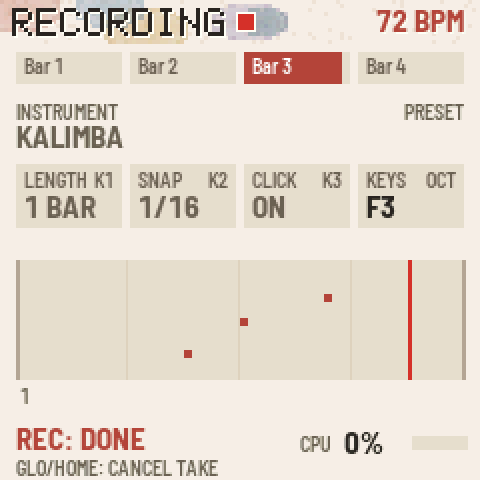
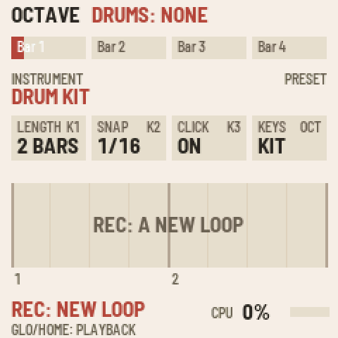

# TIDEPOOL manual

Tidepool is an ambient loop instrument for the M-VAVE FM-1. Each bank is a scene with sixteen loops (drones,
melodies, beats and textures) that always fit together, in time and in key. A thirteenth bank, the Blank Canvas, is
yours to fill with loops you record.

## The scenes

| # | Bank | Mood |
|---|---|---|
| 1 | **Shallows** | Under the water: a low drone, glass arpeggios, kalimba, rain and ocean |
| 2 | **Deep Space** | Event horizons, star bells, sonar and a lone flute |
| 3 | **Forest Floor** | Earth hum, cello, marimba, crickets, a stream and an owl |
| 4 | **Neon Rain** | A city at night: Juno pads, chord stabs, lo-fi beats, rain on glass and traffic |
| 5 | **Dungeon Synth** | Stone organ, lost choir, harpsichord, war drums and cave drips |
| 6 | **Aurora** | The northern lights: glassy pads, ice bells, whale song and sleigh bells |
| 7 | **Dunes** | Dusk in the desert: tanpura, oud, ney flute, darbuka and a campfire |
| 8 | **Zen Garden** | Spring rain in a temple garden: sho, koto, shakuhachi, taiko and wind chimes |
| 9 | **Clockwork** | A workshop of gears: music box, celesta, reed organ, tick-tock and a cuckoo |
| 10 | **Night Café** | Lofi beats on a rainy night: dusty Rhodes, sub bass, boom-bap drums, vinyl crackle, tape wobble |
| 11 | **Bonfire** | Dark fantasy among ruins: a cathedral organ, a solo cello, a lone soprano and a fire to rest at |
| 12 | **Old Blood** | A gothic nightmare: choir, tremolo strings, a warped music box, church bells and crows |
| 13 | **Blank Canvas** | Empty: record your own loops |

Each bank has its own colours, an animated pixel-art banner and its own shape of pool. Bonfire and Old Blood are
written in the mood of Dark Souls and Bloodborne, but every sound, chord and picture in them is original.

## Playing it

When you switch on or change bank, nothing plays yet and the bar counter waits at bar 1. Pick the loops you want on
the white keys (they blink, waiting), then press **PLAY** and they all start together on the first beat. Or press
**SEQ** to let autoplay build the mix for you.

The screen shows the bank's name and tempo, its four chords (the current one lit), and sixteen pools in four rows.
Each pool is a loop that glows in its row's colour while it plays.

### The keys and knobs

| Control | What it does |
|---|---|
| **White keys 1–16** | Turn a loop on or off. Rows, top to bottom: drones, melodies, beats, then textures (rain, wind, fire: the scene's atmosphere). While the music is playing, a loop waits for the next beat to come in, blinking until it does. While it's stopped, a loop you pick blinks until you press PLAY |
| **KNOB 1–4** | Adjust the selected row's four loops, one knob each |
| **OCT− / OCT+** | Choose what the knobs adjust: Volume, Attack, Decay, Reverb, Echo or Pan (shown bottom left) |
| **ALGORITHM** | Choose the row the knobs adjust. Pressing a key selects its row too |
| **SELECT** | Tempo (56–140 bpm) |
| **MASTER** | Main volume |
| **PRESETS** | Change bank. Everything fades out, then the new bank waits at bar 1 for you to pick loops and press PLAY (or SEQ) |
| **SAVE** | Remember the tempo, the bank and every loop's settings in every bank. Lit when there's something unsaved |

### Play, chords and autoplay

| Control | What it does |
|---|---|
| **PLAY** | Start: the loops you've picked come in together, from bar 1. While playing, PLAY stops everything and the counter goes back to bar 1; press it again to bring back the same mix. PLAY blinks when loops are picked and waiting |
| **Hold PLAY, turn KNOB 1** | Change the bank's chord progression. 0 is the bank's own; 1–99 are new ones in the same key, each the same every time. The change comes in at the next bar. Hold PLAY for a moment and the screen reminds you |
| **SEQ** | **Autoplay.** Tidepool brings loops in and out on its own, once every four bars (faster at higher tempos). It builds up from nothing to about two loops in each row, keeps every row going, changes the chords now and then, and changes the texture only rarely. It works on any bank, the Blank Canvas included |
| **SEQ again** | **End autoplay gracefully.** Loops drop out a few at a time, every four bars (the beat first, the drones last), until everything has stopped. SEQ blinks while it ends; press SEQ once more to change your mind |
| **Hold HOME for 3 seconds** | **Surprise me:** a random mix with random settings. A countdown shows on screen; let go early and nothing happens |

## The Blank Canvas: record your own loops

The thirteenth bank starts empty. Its sixteen pools fill with loops you record, and each one keeps its own instrument.
Once recorded, they play like any other bank: turn them on and off, adjust them with the knobs, autoplay them.

**To record a loop:**

1. Turn PRESETS to the Blank Canvas, then press **GLO** to enter recording mode (GLO lights up). The keys now play
   an instrument, and they respond to how hard you press.
2. Set the loop up:
   - **PRESETS** chooses the instrument.
   - **KNOB 1** sets the loop's length: 1, 2 or 4 bars.
   - **KNOB 2** sets the snap: off, 1/16, 1/8, or BAR, where each note starts on a bar line and lasts whole bars,
     for held chords.
   - **KNOB 3** turns the click on or off.
   - **OCT− / OCT+** shift the keys' octave.
3. Press **REC** to start a new loop in the next free pool.
4. Press **REC** again. A one-bar count-in starts at the next bar line (straight away if nothing is playing yet),
   then recording begins.
5. Play. The loop goes round and round its length, and each pass adds to what's already there, so you can build it
   up layer by layer.
6. Press **REC** a third time to keep it. It is saved straight away (no need to press SAVE) and keeps playing, so
   you can go straight on to record the next loop over it.

GLO during a take cancels it. **GLO** or **HOME** takes you back to playback. **PLAY** starts and stops the mix
while you record, so you can record over other loops.

**To delete a loop:** hold **EDIT** and tap the loop's key (its pool blinks red), then tap the same key again. Any
other key cancels.

### The 36 instruments

| Kind | Instruments |
|---|---|
| Keys | Felt keys, Warm organ, Rhodes, Harpsichord, Celesta, Toy piano |
| Plucked and struck | Glass bell, Kalimba, Pluck, Harp, Marimba, Music box, Nylon guitar, Vibraphone, Koto, Oud, Steel pan |
| Strings, winds and voices | Soft pad, Choir, Cello, Flute, Mellow brass, Strings, Shakuhachi, Violin, Muted trumpet, Soprano |
| Leads | Chip lead, Synth lead |
| Bass | Sub bass, Moog bass, Upright bass |
| Bells | Temple bell, Singing bowl |
| Drums | **Drum kit** and **Hand drums**: each key plays a different drum (the octave buttons don't change them) |

**Drum kit**, from the lowest key: kick, rim, snare, clap, low tom, closed hi-hat, mid tom, high tom, pedal hi-hat,
crash, open hi-hat and ride. From the second F up: deep kick, shaker, brush, tambourine, cowbell and ride. The top
keys repeat the main drums.

**Hand drums**: darbuka (deep and rim strokes), riq, frame drum, taiko and small taiko, wooden clappers, udu,
finger cymbals, two agogo bells and shaker, repeating up the keyboard.
